<picture>
  <source media="(prefers-color-scheme: dark)" srcset="assets/intro-dark.svg">
  <source media="(prefers-color-scheme: light)" srcset="assets/intro-light.svg">
  
</picture>

### On the workbench

**[PatchBench](https://github.com/Namprire/patchbench)** · A research workbench for coding agents.

Turn repository history into reproducible bug-fix tasks, evaluate agent patches with executable tests, and explore the evidence in a visual console.

Build and Run workspace demo in simulation mode. The public repo includes runnable synthetic examples.

### A few other experiments

| Robots & language | AI & the work we do |
|:---|:---|
|  |  |
| **[SmolVLA language sensitivity](https://github.com/Namprire/SmolVLA)** What changes in a robot's predicted actions when only the instruction changes? Python · PyTorch · LeRobot · MuJoCo | **[Who Does the Work?](https://github.com/Namprire/Tableau)** An interactive look at AI automation and augmentation across 3,963 workplace tasks. Svelte · JavaScript · Tableau |

**Also in the notebook:** [ArrivalPackLite](https://github.com/Namprire/plane-project) — an offline SwiftUI travel app for communicating Japanese destinations to taxi drivers.

---

I like turning a technical question into an experiment you can run, inspect, and understand.
